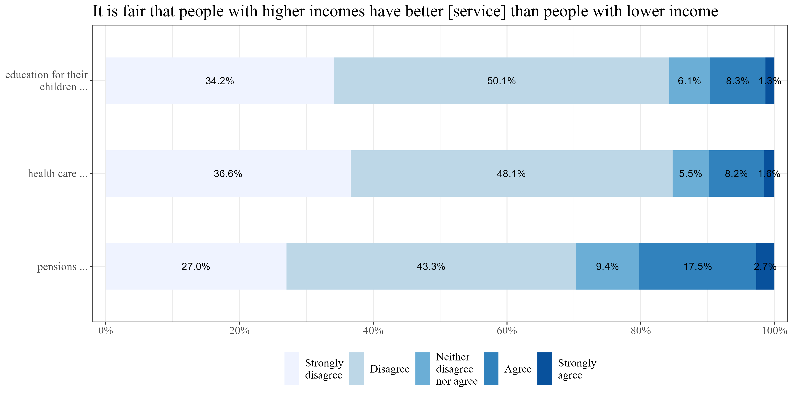
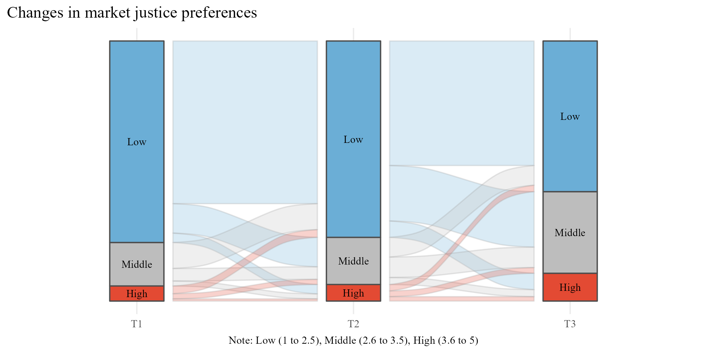
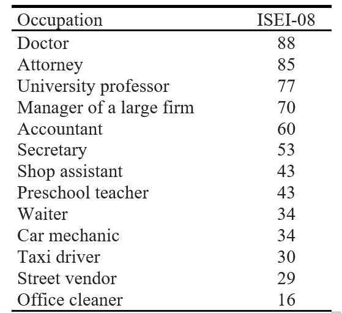
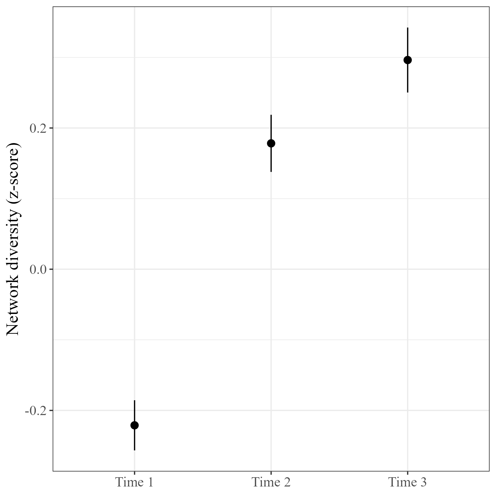
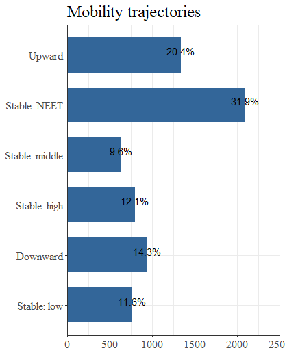

# Methods {background-color="#491106ff"}

## Data

::: {.incremental .highlight-last style="font-size: 120%;"}

- [ELSOC (COES)](https://coes.cl/elsoc/): representative panel of Chile's urban adult population, using probabilistic, stratified, cluster, and multistage sampling in large and small cities

- Period: three waves (2016, 2018 and, 2023)

- Attrition 2016→2023: ~ 40%

- Analytical sample (3 waves): 

    * **N = 6,562 observations**  nested in 
    * **N = 2,884  individuals** 

:::

## Methods

:::: {.incremental style="font-size: 110%;"}

**Multilevel Between-Within regression** (Schmidt-Catran, 2016; Singer & Willett, 2009)

- Panel structure: repeated observations nested within individuals


- **Between effects (BE)** capture how individuals who differ in their average level of a predictor ($\beta_B \bar{x}_i$) differ from each other in the outcome.

- **Within effects (WE)** capture how deviations from an individual’s own mean $\beta_W \bigl(x_{it} - \bar{x}_i\bigr)$ are associated with changes in the outcome over time.


- Equation:

::: {.fragment}

$$\begin{aligned}
y_{it} &= \beta_0 + \beta_W \bigl(x_{it} - \bar{x}_i\bigr) + \beta_B \bar{x}_i
          + \boldsymbol{\gamma}^\top \mathbf{z}_i + u_i + \varepsilon_{it}, \\
u_i &\sim \mathcal{N}(0, \sigma_u^2), \quad
\varepsilon_{it} \sim \mathcal{N}(0, \sigma^2).
\end{aligned}$$ 
:::

::::

## I. Market justice preferences


:::: {.columns}

::: {.column width="80%"}

</br>

```{r external-image, echo=FALSE, out.width="120%"}

```
:::

::: {.column width="20%; font-size: 50%;"}
In this study:

- The Cronbach alpha is close to 0.8 in all time points (α1 =.82, α2=.86, α3=.83)
- Single indicator based on the combination of the three items

> Higher values represent greater support for market justice.
:::

::::

## I. Market justice preferences

```{r, echo=FALSE, out.width="100%"}

```


## II. Social networks: position generator

:::: {.columns}

::: {.column width="60%"}

```{r , echo=FALSE, out.width="100%"}

```
:::

::: {.column width="40%; font-size: 70%;"}

“Now I will ask you about some of your **acquaintances**. It doesn't matter if they are close to you (family or friends) or not. A person is your acquaintance if you at least know their first name, and if you could have a conversation with them if you meet them on the street or in a shopping centre. 

Thinking only of people living in Chile, could you tell me, based on the following sheet and even approximately, how many people you know are...?”

1. None 
2. One 
3. Between 2 and 4 
4. Between 5 and 7 
5. Between 8 and 10 
6. Between 11 and 15 
7. 16 or more

:::

::::

## III. Network diversity index

:::: {.columns}

::: {.column width="60%"}

```{r , echo=FALSE, out.width="100%"}

```
:::

::: {.column width="40%; font-size: 75%;"}

Studies recommend using a single dimension to more accurately capture the network attribute [(Sapin et al., 2020;Otero & Mendoza, 2023)]{style="color: blue; font-weight: bold;"}.

PCA*:

* **Extensivity** (1 – 13): degree of variety as the total number of known occupations.
* **Generalized Entropy** (0 – 1): degree of balance across groups based on the number of acquaintances in each occupation.

This strategy consider both the possible ties to the available occupations (Variety) and how these ties are distributed across each group (Balance) [(Koopmans & Schaeffer, 2015)]{style="color: blue; font-weight: bold;"}. 

*Note: ~90% of explained variance  

:::

::::

## IV. Intragenerational social mobility trajectories

:::: {.columns}

::: {.column width="60%"}

```{r , echo=FALSE, out.width="70%"}

```
:::

::: {.column width="40%; font-size: 75%;"}


* To construct the trajectories of intragenerational mobility or simply "mobility profiles", I used four categories for individuals’ occupational status: low, middle, high, and NEET. 

* Two-stage: First, individuals are categorized based on their first and last observed positions to identify profiles of mobility and stability. Second, to ensure a more robust classification of stability, I implemented the Class Mode Approach (Ares & Van Ditmars, 2025; Helgason & Rehm, 2024). 

* Here, those who participated in the panel for three to four waves and remained in the same position for at least 75% of the time are classified as stable. 


:::

::::


