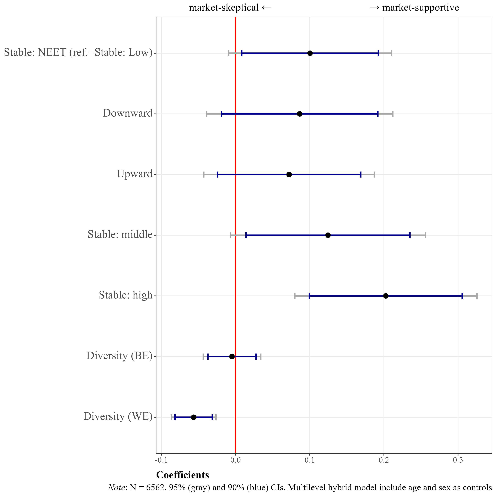
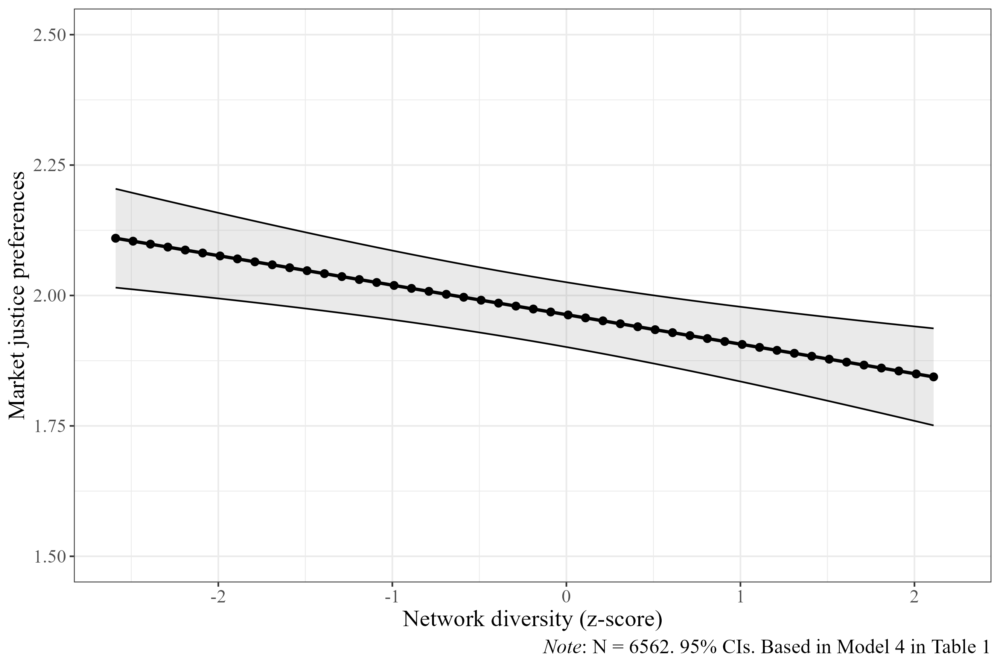

# Results {background-color="#491106ff"}

## Longitudinal results on network diversity and market justice 

:::: {.columns}

::: {.column width="60%"}

```{r , echo=FALSE, out.width="100%"}

```

:::

::: {.column width="40%; font-size: 90%;"}

* Individual stable in high-status positions show 0.203 market justice preferences compared to those stable in low-status occupations (β = 0.203, p>0.05). 

* One standard deviation increase in diversity drives a decrease of -0.057 in the market justice scale (β =-0.057, p<0.001).

* Robust to the inclusion of network size and network socioeconomic status

:::

::::  


## Changes on network diversity 

:::: {.columns}

::: {.column width="70%"}
<!-- </br> -->

```{r , echo=FALSE, out.width="120%"}

```

:::

::: {.column width="30%; font-size: 90%;"}

* When network diversity is at the 20th percentile, the average predicted market justice preference is 2.00 (95% CI: 1.92   2.05), and it decreases to 1.94 when it is at the 80th percentile (95% CI:  1.87-2.00). 

* According to the original scale (1 to 5) of the market justice preferences index, this difference represents a change of around 3%.

:::

::::  

